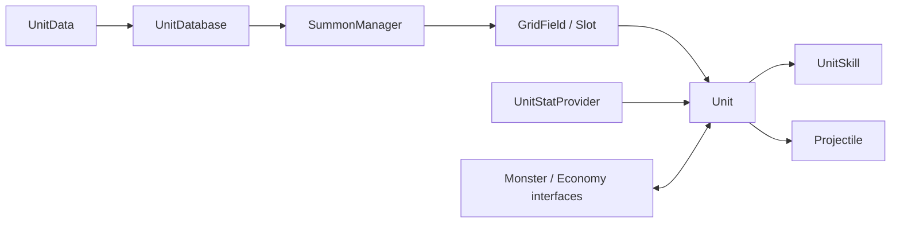

# Defense Rush — Unit System

`운빨존많겜`에서 영감을 받은 3D 디펜스 게임의 유닛 시스템 코드입니다. 원작의 2D 플레이 구조를 3D 전장과 유닛 모델에 맞춰 재구성했습니다.

> 이 문서는 팀 프로젝트에서 제가 담당한 Units 영역을 소개합니다. 전체 게임이 아닌 유닛 관련 코드 샘플을 기준으로 작성했습니다.

## 프로젝트 개요

| 항목 | 내용 |
| --- | --- |
| 프로젝트 | Defense Rush |
| 장르 | 3D 디펜스 게임 |
| 진행 기간 | 1개월 |
| 팀 구성 | 5명 (프로그래머 3명, UI 2명) |
| 담당 역할 | 조장, Units 시스템 프로그래밍 |
| 개발 환경 | Unity 6000.3.25f1, C#, URP |

프로그래머는 MainScene, Enemies, Units 영역을 나눠 개발했고, 저는 조장으로서 Units 시스템을 구현했습니다.

## 플레이 화면

<!-- 나중에 캡처한 GIF 또는 이미지를 docs/images/에 추가하고 아래 주석을 해제하세요.

-->

## 주요 기능

### 유닛 소환과 등급

- 유닛 데이터를 일반, 희귀, 영웅, 전설 등급으로 관리합니다.
- 등급별 가중치로 소환 등급을 결정하고, 해당 등급의 유닛 중 하나를 무작위로 선택합니다.
- 소환 비용, 빈 슬롯, 필드의 최대 유닛 수를 확인한 뒤 배치합니다.
- 작업한 유닛 목록에는 총 32종의 유닛이 정리되어 있습니다.

### 그리드와 승급

- 기본 3×5 그리드에 유닛을 배치합니다.
- 같은 종류의 유닛은 한 슬롯에 최대 3마리까지 쌓을 수 있습니다.
- 슬롯이 가득 차면 다음 등급의 무작위 유닛 1마리로 승급합니다.
- 유닛 판매, 슬롯 재배치, 같은 종류 유닛의 스택 정리를 지원합니다.

### 자동 전투

- 유닛이 공격 범위 안의 몬스터를 주기적으로 탐색해 자동으로 공격합니다.
- 근거리 공격과 투사체 공격을 지원합니다.
- 애니메이션 이벤트에 맞춰 공격 판정과 투사체를 내보낼 수 있습니다.
- 공격, 발사, 적중, 처치, 이동 상태를 이벤트로 알리고 애니메이션과 이펙트를 연결합니다.

### 패시브 스킬

스킬은 `UnitSkill`을 상속하는 `ScriptableObject`로 구현합니다. 소환, 공격, 처치, 라운드 시작, 그리드 변경 시점에 맞춰 스킬 효과를 실행합니다.

구현한 스킬 효과에는 치명타, 멀티샷, 폭발, 연쇄 번개, 슬로우, 출혈, 방어력 감소, 아군 능력치 오라, 코인 획득, 보스 추가 피해 등이 있습니다. 유닛별 스킬 배정표에는 32종의 유닛과 스킬 조합이 정리되어 있습니다.

### 데이터와 밸런스 도구

- `UnitData` 에셋에서 유닛의 등급, 기본 능력치, 프리팹, 투사체, 스킬을 설정합니다.
- `UnitStatTable.csv`를 가져와 유닛 능력치를 ID 기준으로 갱신하는 에디터 도구를 제공합니다.
- `SkillTable.csv`를 읽어 스킬 에셋을 생성·갱신하고 유닛의 스킬 슬롯에 배정합니다.
- 표에 없는 유닛이나 입력되지 않은 열은 유지하고, 적용 전 미리보기 모드를 지원합니다.

### 오브젝트 풀링

유닛 종류별 풀에서 인스턴스를 재사용합니다. 풀에 반환할 때 타겟, 스탯 보정, 슬롯, 씬 참조와 이벤트 구독을 초기화해 다음 사용에 이전 상태가 남지 않도록 처리합니다.

## 구조

### 주요 디렉터리

소스 프로젝트에서 `Assets/02. Scripts/Units/` 아래에 구성한 영역입니다.

| 디렉터리 | 역할 |
| --- | --- |
| `Core/` | 유닛 공통 모델, 등급, 스탯, 풀링 |
| `Grid/` | 그리드 슬롯, 배치·이동 입력, 오라 갱신 |
| `Summon/` | 유닛 데이터베이스, 소환, 승급, 판매 |
| `Skills/` | 패시브 스킬 구현 |
| `Projectile/` | 투사체와 투사체 풀 |
| `Enhance/` | 유닛 스탯 및 소환 확률 강화 |
| `Integration/` | 게임 및 유물 시스템 연결 어댑터 |
| `Contracts/` | 몬스터, 재화, 스탯 제공자 등의 인터페이스 |
| `UI/`, `Visual/` | 유닛 정보, 소환 안내, 범위·등급·스킬 연출 |
| `Tools/Editor/` | 데이터 표 임포터와 미리보기 제작 도구 |

## 구현에서 중점을 둔 점

- **데이터와 동작 분리:** 유닛별 설정은 `UnitData`, 재사용 가능한 스킬 효과는 개별 `UnitSkill` 에셋으로 관리합니다.
- **시스템 간 결합도 낮추기:** 몬스터 목록, 재화, 스탯 제공 기능을 인터페이스로 연결해 Units 코드가 다른 시스템의 구체 구현에 직접 의존하지 않도록 구성했습니다.
- **전투 타이밍 분리:** 공격 시작, 애니메이션 발사 시점, 적중, 처치 이벤트를 나눠 즉시 공격과 투사체 공격을 함께 처리합니다.
- **풀 재사용 상태 관리:** 풀에서 다시 꺼낸 유닛이 이전 전투의 참조나 이벤트를 유지하지 않도록 수명 초기화 로직을 둡니다.

## 기술 스택

- Unity 6000.3.25f1
- C#
- Universal Render Pipeline (URP)
- Unity UI (UGUI), TextMeshPro
- ScriptableObject 기반 데이터 구성
