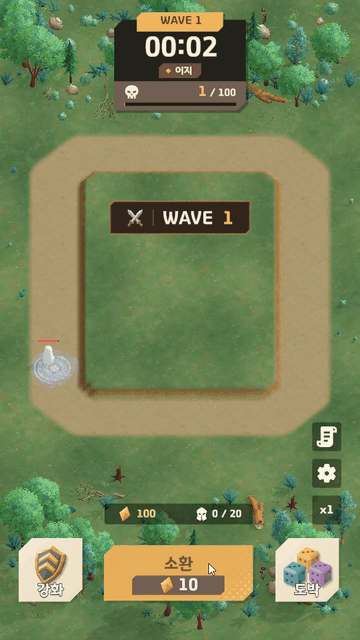
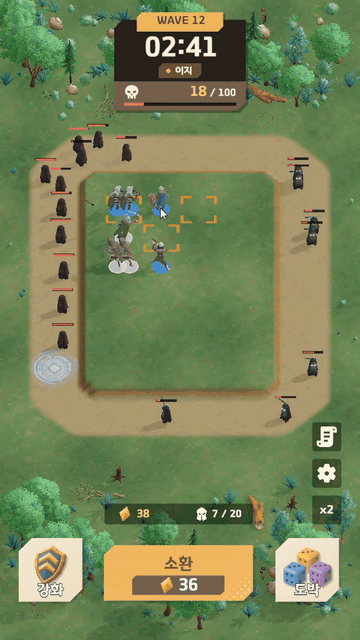
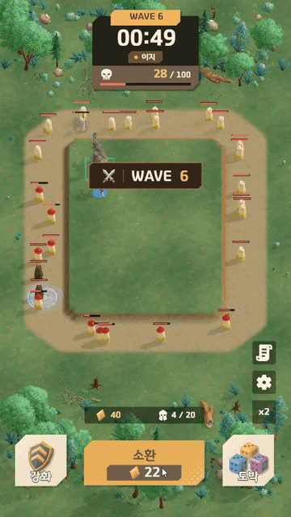
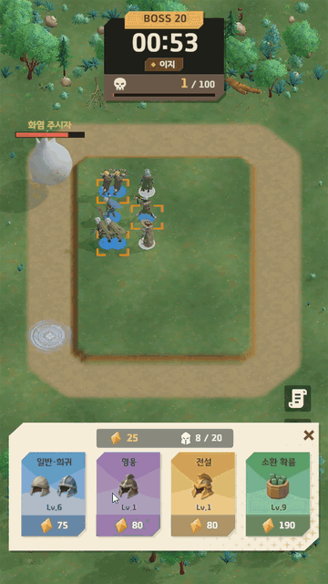
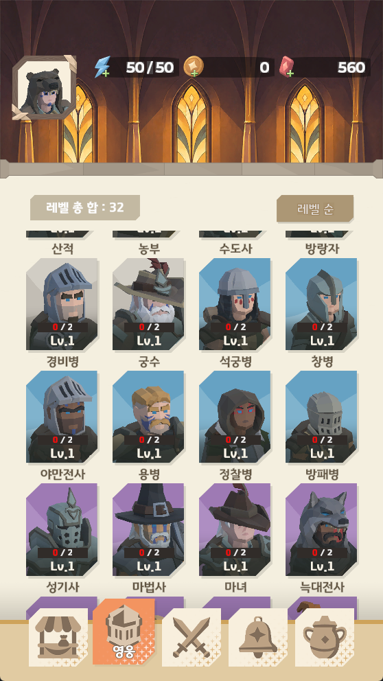
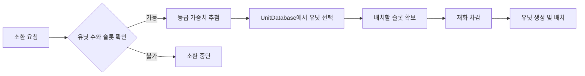
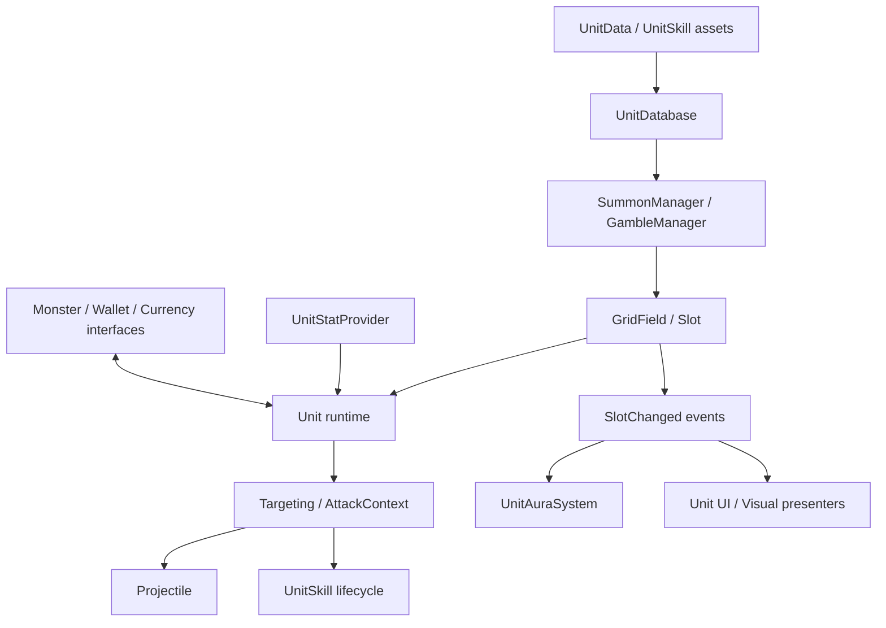

# Defense Rush — Unit Scripts

> `ScriptableObject` 데이터와 전투 로직을 분리하고, 이벤트로 UI·연출을 연결한 3D 디펜스 게임의 유닛 시스템

`운빨존많겜`에서 영감을 받은 3D 디펜스 게임의 유닛 시스템입니다.<br> 원작의 2D 플레이를 3D 전장과 유닛 모델에 맞춰 재구성했습니다.

이 저장소에는 팀 프로젝트 전체가 아니라 제가 맡아 개발한 Units 코드만 따로 정리했습니다.<br> 유료 에셋과 팀원의 MainScene·Enemies 코드는 포함하지 않았습니다. 자세한 범위는 [공개 범위](#공개-범위)에 적었습니다.

[📦 빌드 다운로드](https://drive.google.com/file/d/1FcifTRjN9o3C1SgS-OdaaTdD3rvKAray/view?usp=drive_link) | [GitHub 코드 저장소](https://github.com/gesua/DefenseRush_UnitScripts)

<!-- 시연 영상이나 빌드 링크가 생기면 위 링크 줄을 아래 형태로 바꾸세요.
[🎮 시연 영상](영상 링크) | [📦 빌드 다운로드](https://drive.google.com/file/d/1FcifTRjN9o3C1SgS-OdaaTdD3rvKAray/view?usp=drive_link) | [GitHub 코드 저장소](https://github.com/gesua/DefenseRush_UnitScripts)
-->

## 플레이 영상 및 화면

<table>
  <tr>
    <td width="50%">
      <strong>유닛 소환과 배치</strong><br>
      
    </td>
    <td width="50%">
      <strong>유닛 스킬과 강화</strong><br>
      
    </td>
  </tr>
  <tr>
    <td width="50%">
      <strong>유닛 승급과 프리뷰</strong><br>
      
    </td>
    <td width="50%">
      <strong>보스 전투</strong><br>
      
    </td>
  </tr>
</table>

## 프로젝트 개요

| 항목 | 내용 |
| --- | --- |
| 프로젝트 | Defense Rush |
| 장르 | 3D 디펜스 게임 |
| 개발 기간 | 1개월 |
| 팀 구성 | 5명 (프로그래머 3명, UI 2명) |
| 담당 | 조장, Units 시스템 프로그래밍 |
| 규모 | C# 스크립트 115개, 약 11,600줄 / 유닛 32종 / 패시브 스킬 21종 |
| 핵심 키워드 | `ScriptableObject` 데이터 설계, 오브젝트 풀링, 이벤트 기반 UI·연출, 인터페이스 계약,<br> 애니메이션 이벤트 동기화, Editor 확장(CSV 임포터), `RenderTexture` 프리뷰 |
| Unity | 6000.3.25f1 |
| 렌더 파이프라인 | Universal Render Pipeline (URP) |

프로그래머 3명이 MainScene, Enemies, Units로 개발 영역을 나눴고 저는 Units를 담당했습니다.<br> UI 담당 2명과는 유닛 정보, 선택, 강화 같은 화면 흐름을 연결했습니다.

## 유닛 시스템 요약

| 기능 | 구현 내용 |
| --- | --- |
| 유닛 데이터 | `ScriptableObject`로 등급, 스탯, 프리팹, 투사체, 스킬을 설정 |
| 소환 | 등급별 가중치에 따른 무작위 소환, 재화와 필드 공간 확인 |
| 배치 | 3×5 그리드, 슬롯당 같은 종류 최대 3마리, 드래그 이동 |
| 성장 | 가득 찬 슬롯의 승급, 로비 유닛 강화, 인게임 등급 강화 |
| 전투 | 자동 타겟 선택, 근거리·투사체 공격, 애니메이션 이벤트 연동 |
| 스킬 | 공격·처치·라운드·배치 시점에 동작하는 패시브 스킬 |
| 편의 기능 | 등급 도박, 유닛 판매, 유닛 정보·프리뷰, 사거리·오라 표시 |
| 제작 도구 | CSV 능력치·스킬 표를 `UnitData` 및 스킬 에셋에 반영하는 에디터 도구 |

## 핵심 구현 사례

유닛 시스템에서 상태가 어긋나기 쉬운 지점 다섯 가지를 문제 → 해결 → 결과 순서로 정리했습니다.

### 1. 공격 애니메이션과 전투 판정 동기화

| 구&#8288;분 | 내용 |
| --- | --- |
| **문제** | 일부 유닛은 공격 판정과 투사체 생성이 모션 시작이 아니라 실제 발사 프레임에 일어나야 합니다.<br> 애니메이션 이벤트에만 의존하면 이벤트가 누락될 때 공격이 멈추고, 공격이 취소된 직후 이전 클립에서 늦게 도착한 이벤트로 같은 공격이 중복 발사될 수 있습니다. |
| **해결** | `Unit`이 공격을 '대기 중 공격'으로 보관하고, 애니메이션 이벤트가 오면 타겟과 사거리를 다시 확인한 뒤 스킬을<br> 실행합니다. 이벤트가 오지 않으면 다음 공격 시각을 제한 시간으로 삼아 자동 발사하고,<br> 타겟이 사라지거나 유닛이 이동해 공격이 취소되면 대기 상태를 정리한 뒤 `AttackCanceled` 이벤트를 보냅니다.<br> 취소 직후 짧은 블렌딩 시간(`ATTACK_CANCEL_BLEND_TIME`) 동안 도착한 발사 이벤트는 무시합니다. |
| **결과** | 즉시 공격과 모션 프레임에 맞춘 공격을 같은 전투 로직에서 처리합니다.<br> 타겟 변경, 이동, 애니메이션 취소 상황에서도 공격이 멈추거나 중복 발사되지 않습니다. |

코드: [`Unit`](Core/Unit.cs)의 `BeginPendingAttack`, `UpdatePendingAttack`, `ReleaseAttack`, `AbortPendingAttack`

### 2. 풀링 중인 유닛과 비행 중 투사체

| 구&#8288;분 | 내용 |
| --- | --- |
| **문제** | 투사체가 날아가는 동안 발사한 유닛이 판매되거나 승급되면 해당 오브젝트는 풀에 반환되어<br> 다른 유닛으로 재사용될 수 있습니다.<br> 도착 시 원래 참조를 그대로 쓰면 재사용된 유닛에 과거 공격의 처치·적중 효과가 잘못 붙습니다. |
| **해결** | `Unit`은 풀에서 대여될 때마다 `Lease` 번호를 올리고, 투사체는 발사 시점의 번호를 저장합니다.<br> 적중 시 번호가 일치하면 원래 유닛에 처치·적중 효과를 알리고,<br> 달라졌다면 이전 발사자의 스킬을 호출하지 않고 투사체 피해만 적용합니다.<br> 타겟이 비행 중 사망하면 마지막 위치까지 진행한 뒤 적중 처리를 건너뜁니다. |
| **결과** | 이미 발사된 공격은 유지하면서, 재사용된 유닛에 과거 처치 효과가 잘못 붙지 않습니다. |

**[`Projectile.Arrive`](Projectile/Projectile.cs#L160-L174) (발췌): 발사자가 재사용됐는지 확인**

```csharp
// 쏜 유닛이 그 사이 풀로 돌아갔거나 다른 유닛으로 재사용됐으면 (판매, 승급) 대미지만 주고 처치 효과는 없다.
if (_owner.Lease == _ownerLease) _owner.ApplyHit(_target, _damage, _damageKind);
else MonsterSkillDamage.Apply(_target, _damage, _damageKind);
```

### 3. 배치가 바뀔 때만 다시 계산하는 오라

| 구&#8288;분 | 내용 |
| --- | --- |
| **문제** | 인접 유닛에게 주는 오라는 유닛이 이동·판매·승급될 때마다 달라져야 합니다.<br> 한 번만 걸면 이전 보정이 남고, 매 프레임 갱신하면 불필요한 계산이 생깁니다. |
| **해결** | `GridField`는 소환·이동·판매·승급 때마다 `SlotChanged` 이벤트를 보냅니다. `UnitAuraSystem`은 이 이벤트를<br> 받아 모든 유닛의 오라 보정을 지우고, 현재 배치 기준으로 각 스킬의 `ApplyAura`를 처음부터 다시 호출합니다. |
| **결과** | 유닛이 이동하거나 판매·승급되어도 이전 오라가 남지 않고, 계산은 배치가 바뀔 때만 일어납니다.<br> 오라 범위는 `Visual/`의 표시 컴포넌트가 바닥 칸으로 보여줍니다. |

코드: [`UnitAuraSystem`](Grid/UnitAuraSystem.cs), [`SlotAuraFloorPresenter`](Visual/SlotAuraFloorPresenter.cs)

### 4. 표에서 에셋을 갱신하는 안전한 흐름

| 구&#8288;분 | 내용 |
| --- | --- |
| **문제** | 유닛 32종과 스킬 21종의 수치를 Inspector에서 하나씩 입력하면 실수하기 쉽고,<br> 밸런스를 바꿀 때마다 반복해야 합니다. 에셋을 새로 만들면 유닛과의 연결이 끊어질 수도 있습니다. |
| **해결** | 스프레드시트에서 내보낸 CSV를 읽는 에디터 임포터를 만들었습니다. 능력치 임포터는 표의 `unitId`로<br> `UnitData`를 찾아 갱신하고, 중복 ID·없는 ID·잘못된 숫자를 결과 보고서에 남깁니다.<br> 스킬 임포터는 `skillClass`에 대응하는 에셋을 만들거나 갱신하고,<br> 유닛별 스킬 순서와 추가 슬롯을 표 기준으로 배정합니다.<br> 구현되지 않은 스킬 행은 건너뛰고, 일부만 배정된 유닛은 별도로 보고합니다.<br> 두 임포터 모두 기본값이 '미리보기'이며, 실제 적용 전에는 커밋 여부를 묻는 확인 창을 거칩니다. |
| **결과** | 밸런스 수정이 '표 수정 → 미리보기 → 적용'으로 끝납니다.<br> 이미 있는 에셋은 GUID가 유지되어 유닛 연결이 끊어지지 않고, 표에 없는 유닛이나 빈 칸은 그대로 둡니다. |

**[`SkillTableImporter.CreateOrUpdate`](Tools/Editor/SkillTableImporter.cs#L270-L292) (발췌): 기존 에셋을 갱신하고, 종류가 다르면 중단**

```csharp
// 스킬 에셋을 만들거나(없으면) 값만 갱신한다(있으면). 이미 있는 에셋은 GUID가 그대로라 유닛 연결이 유지된다.
    UnitSkill skill = AssetDatabase.LoadAssetAtPath<UnitSkill>(path);
    isNew = skill == null;

    if (isNew == false && skill.GetType() != binding.AssetType)
        throw new InvalidOperationException($"이미 있는 에셋의 종류({skill.GetType().Name})가 표({binding.AssetType.Name})와 다릅니다.");

    if (_dryRun) return skill;
```

### 5. 3D 유닛 프리뷰 분리

| 구&#8288;분 | 내용 |
| --- | --- |
| **문제** | 유닛 정보창에 3D 모델 프리뷰를 보여주려면 전장의 유닛을 활용하면서도 전장 카메라와 프리뷰가<br> 서로 섞이지 않아야 합니다.<br> 유닛마다 체형이 달라 같은 카메라 설정으로는 카드 안에 맞지 않습니다. |
| **해결** | 전용 카메라와 `RenderTexture`를 사용합니다. 선택한 유닛의 렌더러만 `UnitPreview` 레이어로 옮겨<br> 전장 카메라와 분리하고, 유닛별 프레이밍 값으로 체형이 다른 모델도 카드 안에 맞춥니다.<br> 프레이밍 값은 에디터 도구가 프리팹에서 계산해 데이터에 기록합니다.<br> 프리뷰를 닫거나 유닛이 풀로 돌아가면 원래 레이어를 복원합니다. |
| **결과** | 정보창에서 선택한 유닛을 전용 카메라로 보여주고, 프리뷰를 닫으면 레이어가 원래대로 돌아갑니다. |

코드: [`UnitPreviewController`](UI/UnitPreviewController.cs), [`UnitPreviewFramingBaker`](Tools/Editor/UnitPreviewFramingBaker.cs)

## 먼저 볼 코드

코드를 빠르게 훑어보실 때는 아래 순서를 권합니다.

| 순&#8288;서 | 파일 | 볼 곳 |
| --- | --- | --- |
| 1 | [`Core/Unit.cs`](Core/Unit.cs) | 타겟 탐색, 공격 주기, 대기 중 공격<br>(`BeginPendingAttack`, `UpdatePendingAttack`), `Lease` |
| 2 | [`Grid/GridField.cs`](Grid/GridField.cs) | 칸 생성과 좌표 변환, [`TryMove`](Grid/GridField.cs#L263), `ConsolidateStacks` |
| 3 | [`Skills/UnitSkill.cs`](Skills/UnitSkill.cs) | 스킬 생명주기 훅, 구현 예시 [`ChainLightningSkill`](Skills/ChainLightningSkill.cs) |
| 4 | [`Projectile/Projectile.cs`](Projectile/Projectile.cs) | 궤도 이동, [`Arrive`](Projectile/Projectile.cs#L160-L174) |
| 5 | [`Tools/Editor/SkillTableImporter.cs`](Tools/Editor/SkillTableImporter.cs) | CSV → 스킬 에셋 생성·갱신, 미리보기 모드 |

## 유닛 데이터 구성

유닛 목록과 스킬 배정표에는 총 32종을 정리했습니다.<br> 게임에 반영한 수치는 [`UnitStatTable.csv`](Tools/Editor/UnitStatTable.csv), 스킬 배정은 [`SkillTable.csv`](Tools/Editor/SkillTable.csv)에 있습니다.

| 등급 | 수량 | ID 범위 |
| --- | ---: | --- |
| 일반 | 6 | 101–106 |
| 희귀 | 6 | 201–206 |
| 영웅 | 10 | 301–310 |
| 전설 | 10 | 401–410 |

각 유닛은 `UnitData` 에셋으로 정의합니다. 에셋은 고유 ID와 표시 이름, 등급, 모델 프리팹, 아이콘, 공격력, 공격 속도, 사거리, 근·원거리 구분, 투사체 프리팹, 로비 강화량, 스킬 목록을 보유합니다.

유닛 능력치 표는 `unitId`를 기준으로 에셋을 찾아 값을 갱신합니다.<br> 이름이 바뀌어도 ID가 유지되면 같은 유닛 데이터에 적용할 수 있습니다.<br> 유닛 데이터와 런타임 전투 동작을 분리해 밸런스 조정 시 전투 코드를 바꾸지 않고 값과 스킬 배정을 수정할 수 있게 했습니다.

### 역할별 능력치 기준

32종의 유닛을 같은 방식으로만 설계하지 않고, 공격 속도와 사거리, 단일 대상 DPS를 기준으로<br> 여섯 역할로 나눠 수치표를 구성했습니다.

| 역할 | 유닛 수 | 설계 기준 |
| --- | ---: | --- |
| 기본형 | 9 | 공격력·공격 속도가 균형 잡힌 근거리 유닛 |
| 중량형 | 6 | 공격 속도는 낮고 한 번의 공격력이 높은 유닛 |
| 속공형 | 4 | 짧은 사거리에서 빠르게 공격하는 유닛 |
| 리치형 | 3 | 근거리 계열 중 사거리가 길고 DPS가 낮은 유닛 |
| 사수형 | 6 | 긴 사거리와 낮은 공격력을 가진 원거리 유닛 |
| 마법형 | 4 | 긴 사거리에서 느리고 강한 공격을 하는 유닛 |

밸런스 표의 기본 DPS는 `공격력 × 초당 공격 횟수`로 계산한 단일 대상 기준입니다.<br> 범위 피해, 치명타, 적 체력은 이 비교식에 포함하지 않아 초기 능력치 기준을 맞추는 용도로 사용했습니다.





## 소환과 등급 확률

`SummonManager`는 다음 순서로 소환을 처리합니다.



- 등급 가중치는 Inspector 또는 소환 확률 강화 설정에서 읽습니다.
- 해당 등급의 `UnitData` 중 하나를 선택하고, 같은 종류의 유닛을 더 쌓을 수 있는 슬롯을 우선 사용합니다.
- 유닛 제한이나 빈 슬롯 부족으로 소환할 수 없으면 재화를 쓰지 않습니다.
- 소환 확률 강화와 유닛 스킬·유물 효과가 등급별 가중치에 반영됩니다.

<!-- TODO: 소환 확률 UI와 소환 결과가 함께 보이는 캡처 추가

-->

## 그리드, 드래그, 승급과 판매

기본 필드는 3행 5열이며, 슬롯은 같은 종류의 유닛만 최대 3마리까지 받습니다.<br> 기본 필드 유닛 수 제한은 20마리이고 유물 효과로 늘릴 수 있습니다.

`GridField`와 `Slot`은 행·열 인덱스와 3D 월드 좌표를 함께 관리합니다.<br> 한 슬롯의 여러 유닛은 슬롯 중심 주위에 원형으로 배치하고, 공격 사거리는 모델의 실제 위치가 아니라 슬롯 중심에서<br> XZ 평면 거리로 계산합니다.<br> 같은 칸의 유닛이 일관된 공격 범위를 쓰고, 높낮이에 따라 사거리 판정이 달라지지 않도록 3D 전장 규칙을 명시했습니다.

`GridDragInput`은 Unity `EventSystem` 포인터 이벤트로 탭과 드래그를 처리합니다.<br> UI에서 시작된 입력은 그리드 조작으로 전달하지 않으며, 드래그 시작·이동·종료를 이벤트로 보내 가이드나<br> 슬롯 선택 UI가 별도로 반응하도록 했습니다.

드래그로 슬롯 전체를 옮길 때는 대상 칸의 상태에 따라 이동, 합치기, 교환으로 나뉘며 한 메서드에서 처리합니다.

**[`GridField.TryMove`](Grid/GridField.cs#L263) (발췌): 빈 칸 이동 · 합치기 · 교환**

```csharp
if (to.IsEmpty)
{
    to.AddRange(from.TakeAll());                // 빈 칸: 스택 전체 이동
}
else if (to.Type == from.Type)
{
    if (to.IsFull) return false;                // 같은 종류 + 가득 참: 원위치
    while (to.IsFull == false && from.IsEmpty == false)         // 같은 종류: 자리만큼 합치기
        to.Add(from.TakeLast());
}
else
{
    List<Unit> fromUnits = from.TakeAll();      // 다른 종류: 두 칸 교환
    List<Unit> toUnits = to.TakeAll();
    from.AddRange(toUnits);
    to.AddRange(fromUnits);
}
```

<!-- TODO: 빈 칸 이동, 같은 종류 합치기, 다른 종류 교환 중 대표 장면 GIF 추가

-->

### 승급

슬롯이 가득 찬 상태에서 승급하면 기존 유닛을 비우고 다음 등급의 유닛 한 마리를 무작위로 생성합니다.<br> 생성될 유닛과 같은 종류가 필드에 있고 쌓을 공간이 있으면 그 슬롯에 합쳐 배치합니다.

### 판매

슬롯의 유닛을 한 마리씩 판매하고 등급별 재화를 지급합니다. 재화를 받지 못하면 유닛을 제거하지 않습니다.<br> 판매 후에는 같은 종류가 여러 슬롯에 나뉘어 있을 때 `ConsolidateStacks`가 남은 유닛을 가능한 슬롯에 다시 모읍니다.<br> 예를 들어 3마리 칸과 2마리 칸이 있을 때 3마리 칸에서 한 마리를 팔면 2 + 2가 아니라 3 + 1로 정리합니다.

<!-- TODO: 3마리 승급 또는 판매 후 스택 정리를 보여주는 GIF 추가

-->

## 자동 전투와 투사체

각 `Unit`은 타겟을 다시 찾고, 슬롯 중심 기준 사거리 안의 몬스터를 자동으로 공격합니다.

- 타겟 탐색, 이동, 적 방향 회전을 유닛 동작 안에서 관리합니다.
- 투사체가 없는 공격은 즉시 적용하고, 투사체가 설정된 유닛은 발사체가 적에게 도달한 시점에 적중 처리를 합니다.
- `UnitData`에서 공격 효과를 공격 시작 시점 또는 애니메이션 발사 이벤트 시점에 실행하도록 선택할 수 있습니다.<br> 이벤트 누락과 취소 처리는 핵심 구현 사례 1에 정리했습니다.
- 공격 시작(`Attacked`), 발사(`Released`), 취소(`AttackCanceled`), 적중(`Hit`), 처치(`Killed`)<br> 이벤트를 분리해 애니메이션과 전투 이펙트를 연결합니다.

투사체는 직선 또는 포물선 궤도로 이동하며, 움직이는 타겟은 비행 중에도 조준점을 갱신합니다.<br> 타겟이 비행 중 사망하면 마지막 위치까지 진행한 뒤 적중 처리를 건너뜁니다.

<!-- TODO: 근거리 공격, 원거리 투사체, 스킬 이펙트가 보이는 전투 GIF 추가

-->

## 패시브 스킬 구조

`UnitSkill`은 스킬 공통 데이터를 담는 추상 `ScriptableObject`이고, 구현은 이를 상속한 21종입니다.<br> 스킬은 유닛별 인스턴스 상태를 저장하지 않고, `UnitData`의 스킬 목록에 에셋으로 연결해 재사용합니다.

스킬 종류별 클래스는 필요한 시점만 재정의합니다.<br> 예를 들어 공격형 스킬은 `OnAttack`, 경제 스킬은 `OnSpawned` 또는 `OnRoundStart`, 오라 스킬은 `ApplyAura`를 구현합니다.

**[`UnitSkill`](Skills/UnitSkill.cs#L61-L82) 생명주기 (발췌)**

```csharp
public virtual void OnSpawned(Unit unit) { }
public virtual void OnAttack(AttackContext context) { }
public virtual void OnKill(Unit unit, IMonster target) { }
public virtual void OnRoundStart(Unit unit, int round) { }
public virtual void ApplyAura(Unit unit) { }
```

처치한 자리가 필요한 스킬(시체 폭발)은 사망 위치를 함께 받는 `OnKill` 오버로드를 재정의합니다.<br> 기본 구현이 위치 없는 `OnKill`을 호출하므로 기존 처치 스킬(광분 등)은 그대로 동작합니다.

| 실행 시점 | 용도 예시 |
| --- | --- |
| 유닛 생성 | 약탈처럼 소환·승급 시 발동하는 효과 |
| 공격 | 치명타, 멀티샷, 폭발, 연쇄 번개, 슬로우, 출혈 |
| 적 처치 | 처치 보상, 광분, 시체 폭발 |
| 라운드 시작 | 수확처럼 라운드마다 발동하는 효과 |
| 필드 구성 변경 | 인접 유닛 능력치를 바꾸는 공격력·공격 속도 오라 |

이 밖에 방어력 감소, 처형, 충격파, 거인 학살, 보스 사냥꾼, 축복, 일시 버프 등 공격·제어·지원·경제 계열을 구현했습니다.<br> 일반·희귀 유닛은 기본 스킬 슬롯 1개, 영웅·전설은 2개를 가지며 일부 유닛은 추가 슬롯을 설정할 수 있습니다.

| 계열 | 예시 | 발동 방식 |
| --- | --- | --- |
| 피해 강화 | 치명타, 강타, 처형, 거인 학살, 보스 사냥꾼 | 확률 피해, 저체력 적 또는 보스 대상 추가 피해 |
| 범위 공격 | 폭발, 발도, 연쇄 번개, 충격파, 시체 폭발 | 주변 또는 사거리 내 복수의 적에게 피해 |
| 제어·약화 | 슬로우, 출혈, 갑옷 파괴 | 이동 속도 감소, 지속 피해, 방어력 감소 |
| 아군 지원 | 일시 버프, 공격력·공격 속도 오라, 축복 | 일정 시간 아군 강화 또는 필드·소환 확률 보정 |
| 경제 | 약탈, 노획, 수확, 처치 보상 | 유닛 생성, 공격, 라운드 시작, 적 처치 시 재화 획득 |

<!-- TODO: 범위 스킬 또는 아군 오라가 바닥에 표시된 장면 캡처 추가

-->

### 오라 갱신

`UnitAuraSystem`은 슬롯 구성 변경 이벤트를 받아 오라 보정을 다시 계산합니다.<br> 계산 방식은 핵심 구현 사례 3에 정리했습니다.<br> 오라 범위는 별도 표시 컴포넌트에서 바닥 칸으로 보여줍니다.

## 강화와 소환 확률 성장

`UnitStatProvider`는 유닛의 기본 능력치, 유닛별 로비 강화, 등급별 인게임 강화를 합산하고 유물 보정을 적용합니다.<br> 인게임 강화는 등급별 레벨로 관리하며, 설정에 따라 여러 등급을 묶어서 함께 강화할 수 있습니다.<br> 강화 상태와 확률 상태는 새 전투가 시작될 때 초기화합니다.

소환 확률 강화는 등급 가중치를 단계별로 변경합니다. 필드의 `축복` 스킬과 확률 증가 유물은 일반 등급의 가중치 일부를<br> 희귀 이상 등급으로 옮기는 방식으로 반영합니다. 관련 UI는 레벨과 가중치가 바뀌는 이벤트를 구독해 표시를 갱신합니다.

## 등급 도박

`GambleManager`는 설정된 희귀·영웅·전설 등급에 대해 비용을 내고 성공 확률을 굴립니다.

- 성공한 등급의 비용만 이후 시도에서 증가합니다. 실패하거나 필드 공간 부족으로 막히면 비용 단계는 오르지 않습니다.
- 재화를 지불하기 전에 필드 제한, 빈 슬롯, 배치할 유닛 데이터를 확인합니다.
- 실패 보상 유물이 있으면 확률에 따라 한 단계 낮은 등급의 유닛을 생성할 수 있습니다.
- 성공, 실패, 재화 부족, 필드 제한 등 결과를 `Gambled` 이벤트로 UI에 전달합니다.

<!-- TODO: 강화 카드 또는 도박 성공·실패 결과 화면 캡처 추가

-->

## 유닛 UI와 3D 프리뷰

- 유닛 정보 패널에서 등급, 능력치, 강화 레벨, 스킬과 현재 버프를 표시합니다.
- 선택 유닛의 공격 사거리를 바닥에 원으로 표시하고, 인접 오라의 적용 슬롯을 시각화합니다.
- 승급 가능 상태, 등급 색상, 소환 확률, 유닛 수 제한, 소환·도박 결과 등을 UI 이벤트로 갱신합니다.
- 선택한 3D 모델을 정보 패널에서 둘러볼 수 있는 프리뷰를 제공합니다.<br> 카메라와 레이어 분리 방식은 핵심 구현 사례 5에 정리했습니다.
- 공격 애니메이션, 손 위치 IK, 무기 표시, 등급 링과 스킬 발동 이펙트도 유닛 이벤트에 연결합니다.

## 에디터 제작 도구

`Tools/Editor/`에는 스프레드시트에서 정리한 밸런스 데이터를 Unity 에셋에 반영하는 도구가 있습니다.

| 도구 | 입력 | 처리 |
| --- | --- | --- |
| Unit Stat Table Importer | `UnitStatTable.csv` | ID로 `UnitData`를 찾아 이름, 공격력, 공격 속도, 사거리,<br> 공격 타입, 로비 강화량 갱신 |
| Skill Table Importer | `SkillTable.csv` | 스킬 유형에 맞는 에셋을 생성·갱신하고 유닛별 슬롯에 배정 |
| Skill Icon Assigner | 스킬 에셋과<br> 아이콘 자료 | 이름 기준으로 스킬 아이콘 연결 |
| Unit Preview Framing Baker | 유닛 프리팹 | 프리뷰 카메라의 중심과 크기를 계산해 데이터에 기록 |
| Summon Manager Inspector | 선택한 `UnitData`와<br> 마릿수 | 플레이 중 원하는 유닛을 목록에서 골라 필드에 소환하는<br> 개발용 치트 |

코드: [`UnitStatTableImporter`](Tools/Editor/UnitStatTableImporter.cs), [`SkillTableImporter`](Tools/Editor/SkillTableImporter.cs#L270-L292)

<!-- TODO: CSV 미리보기 결과나 Unity Inspector에 반영된 UnitData 캡처 추가

-->

## 구조



### 주요 코드

| 클래스 | 책임 |
| --- | --- |
| [`Unit`](Core/Unit.cs) | 필드 유닛의 이동, 타겟 탐색, 공격 주기, 스킬 호출,<br> 적중·처치 이벤트 |
| [`UnitData`](Core/UnitData.cs) / [`UnitDatabase`](Summon/UnitDatabase.cs) | 유닛별 데이터와 등급별 검색·무작위 선택 |
| [`GridField`](Grid/GridField.cs) / [`Slot`](Grid/Slot.cs) | 3D 월드 그리드, 스택 이동·합치기·교환, 승급·판매 후 재배치 |
| [`SummonManager`](Summon/SummonManager.cs) / [`PromotionManager`](Summon/PromotionManager.cs) / [`SellManager`](Summon/SellManager.cs) | 기본 소환, 승급, 판매 규칙 |
| [`GambleManager`](Gamble/GambleManager.cs) | 확률 도박, 등급별 비용 증가, 실패 보상과 결과 이벤트 |
| [`UnitSkill`](Skills/UnitSkill.cs) 및 파생 클래스 | 공통 스킬 생명주기와 개별 패시브 효과 |
| [`UnitPool`](Core/UnitPool.cs) / [`ProjectilePool`](Projectile/ProjectilePool.cs) | 유닛·투사체 인스턴스 재사용과 수명 정리 |
| [`UnitStatProvider`](Enhance/UnitStatProvider.cs) | 기본 능력치, 로비·인게임 강화, 유물 보정 계산 |
| [`UnitPreviewController`](UI/UnitPreviewController.cs) | 전장과 분리된 유닛 프리뷰 카메라 및 RenderTexture |
| [`UnitStatTableImporter`](Tools/Editor/UnitStatTableImporter.cs) / [`SkillTableImporter`](Tools/Editor/SkillTableImporter.cs) | CSV 데이터 검증 및 Unity 에셋 반영 |

### 주요 디렉터리

| 경로 | 책임 |
| --- | --- |
| `Core/` | `Unit`, `UnitData`, 등급, 스탯, 프리뷰 프레이밍, 풀 |
| `Grid/` | 그리드 필드·슬롯·드래그 입력·오라 갱신 |
| `Summon/` | 유닛 데이터베이스·소환·승급·판매 |
| `Gamble/` | 등급 도박과 결과·비용 설정 |
| `Skills/` | 유닛 패시브 스킬 |
| `Projectile/` | 투사체 이동과 풀 |
| `Enhance/` | 로비·인게임 스탯 강화와 소환 확률 |
| `Contracts/`, `Integration/` | 시스템 경계 인터페이스와 게임 데이터 어댑터 |
| `UI/`, `Visual/` | 유닛 정보, 상호작용, 전투·등급·범위 연출 |
| `Tools/Editor/` | 표 임포터(CSV 포함)와 아이콘·프리뷰 제작 도구 |

## 설계 원칙

- **시스템 경계:** 적 목록, 지갑, 전투 재화, 스탯 제공자는 `IMonsterRegistry`, `IWallet`, `ICurrencyReceiver`, `IUnitStatProvider` 같은 계약으로 연결합니다. 스킬이 필요로 하는 몬스터 기능은 `ISlowable`, `IStunnable`, `IDotReceiver`, `IArmorBreakable`, `IBossTarget`처럼 작은 인터페이스로 나눴습니다.
- **데이터와 로직 분리:** 유닛 설정과 재사용 가능한 스킬 효과는 `ScriptableObject`로 관리하고,<br> 런타임 전투 상태는 `Unit`이 처리합니다.
- **이벤트 기반 표시 갱신:** 슬롯·강화·공격 이벤트를 UI와 이펙트에 전달해 전투 규칙과 표시 로직을 나눕니다.
- **상태 수명 관리:** 풀링, 비행 중 투사체, 오라 재계산처럼 상태가 소환·이동·판매·승급 이후에도 남을 수 있는 경계를<br> 별도로 처리합니다.

## 협업 방식

- **파트 경계는 인터페이스로:** 몬스터·재화·유물 쪽은 `Contracts/`의 인터페이스로 접근하고, 팀 공용 게임 데이터와<br> 닿는 부분은 `Integration/`의 어댑터로 모았습니다.<br> 몬스터 담당과 협의해 스킬에 필요한 기능(감속, 기절, 지속 피해, 방어력 감소, 보스 판별, 체력)을 인터페이스로<br> 정의했고, 몬스터 구현이 완성되기 전에는 테스트용 더미 몬스터로 유닛 전투를 먼저 검증했습니다.
- **씬 충돌 줄이기:** 같은 씬을 함께 작업하는 팀원과는 씬을 복제해 각자 씬에서 프리팹 단위로 작업했습니다.
- **팀장 역할:** Git 병합과 충돌 정리를 맡았습니다.

## 기술 스택

- Unity 6000.3.25f1
- C#
- Universal Render Pipeline (URP)
- Unity UI (UGUI), TextMeshPro
- ScriptableObject 기반 게임 데이터
- Unity `ObjectPool<T>`
- Unity Editor 확장 (CSV 임포터, 베이커, Inspector 도구)

<!-- TODO: 회고 — 구조에서 아쉬웠던 점이나 다시 만든다면 바꿀 점을 3~4줄로 적어 '공개 범위' 위에 넣어 보세요. -->

## 공개 범위

이 저장소는 제가 담당한 Units 시스템의 코드 리뷰를 위한 포트폴리오 샘플입니다. 유료 에셋과 팀원의 MainScene·Enemies<br> 코드는 포함하지 않았습니다. 코드와 데이터는 C# 스크립트(`.meta` 포함)와 밸런스 CSV 2개뿐입니다. 씬, 프리팹, `ScriptableObject` 에셋 등 실행 리소스가 없어 단독 실행 프로젝트는 아닙니다.
