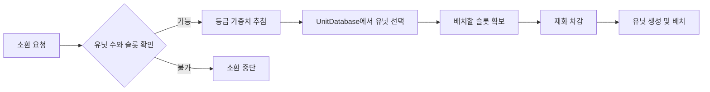
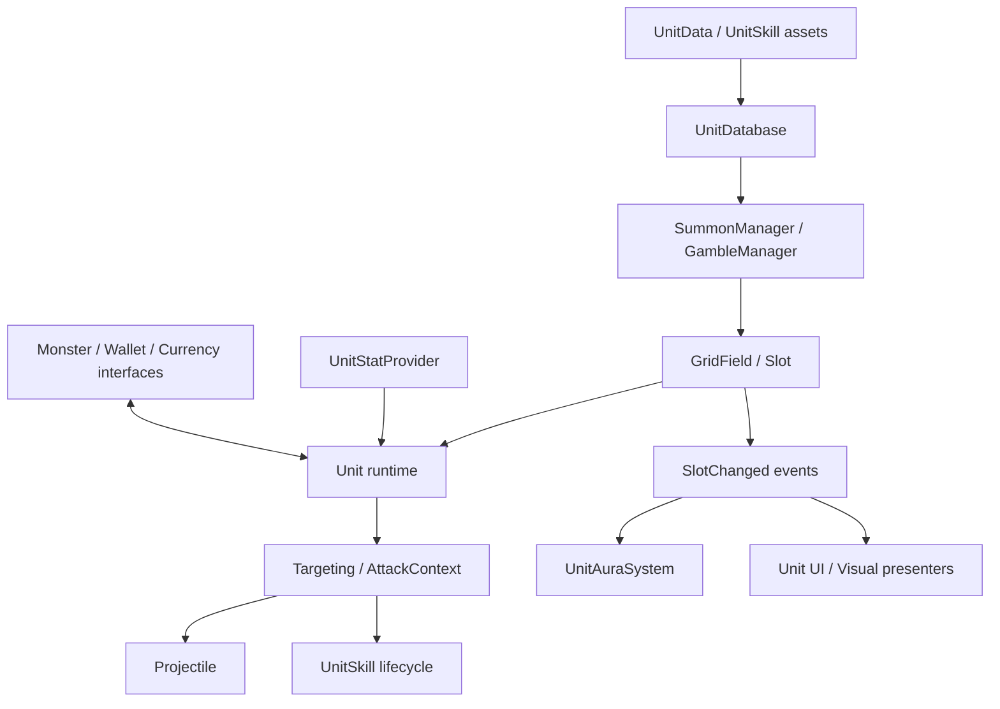

# Defense Rush — Unit Scripts

`운빨존많겜`에서 영감을 받은 3D 디펜스 게임의 유닛 시스템입니다. 원작의 2D 플레이를 3D 전장과 유닛 모델에 맞춰 재구성했습니다.

이 저장소에는 팀 프로젝트 전체가 아니라 제가 맡아 개발한 Units 코드만 따로 정리했습니다. 유료 에셋과 팀원의 MainScene·Enemies 코드는 포함하지 않았습니다.

[GitHub 코드 저장소](https://github.com/gesua/DefenseRush_UnitScripts)

## 플레이 영상 및 화면

아래 주석을 해제하고 캡처 파일 경로를 바꾸면 GIF와 이미지를 추가할 수 있습니다.

<!--


-->

## 프로젝트 개요

| 항목 | 내용 |
| --- | --- |
| 프로젝트 | Defense Rush |
| 장르 | 3D 디펜스 게임 |
| 개발 기간 | 1개월 |
| 팀 구성 | 5명 (프로그래머 3명, UI 2명) |
| 담당 | 조장, Units 시스템 프로그래밍 |
| Unity | 6000.3.25f1 |
| 렌더 파이프라인 | Universal Render Pipeline (URP) |

프로그래머 3명이 MainScene, Enemies, Units로 개발 영역을 나눴고 저는 Units를 담당했습니다. UI 담당 2명과는 유닛 정보, 선택, 강화 같은 화면 흐름을 연결했습니다.

## 유닛 시스템 요약

| 기능 | 구현 내용 |
| --- | --- |
| 유닛 데이터 | `ScriptableObject`로 등급, 스탯, 프리팹, 투사체, 스킬을 설정 |
| 소환 | 등급별 가중치에 따른 무작위 소환, 재화와 필드 공간 확인 |
| 배치 | 3×5 그리드, 슬롯당 같은 종류 최대 3마리, 드래그 이동 |
| 성장 | 가득 찬 슬롯의 승급, 로비 유닛 강화, 인게임 등급 강화 |
| 전투 | 자동 타겟 선택, 근거리·투사체 공격, 애니메이션 이벤트 연동 |
| 스킬 | 공격·처치·라운드·배치 시점에 동작하는 패시브 스킬 |
| 편의 기능 | 등급 도박, 유닛 판매, 유닛 정보·프리뷰, 사거리·오라 표시 |
| 제작 도구 | CSV 능력치·스킬 표를 `UnitData` 및 스킬 에셋에 반영하는 에디터 도구 |

## 유닛 데이터 구성

유닛 목록과 스킬 배정표에는 총 32종을 정리했습니다.

| 등급 | 수량 | ID 범위 |
| --- | ---: | --- |
| 일반 | 6 | 101–106 |
| 희귀 | 6 | 201–206 |
| 영웅 | 10 | 301–310 |
| 전설 | 10 | 401–410 |

각 유닛은 `UnitData` 에셋으로 정의합니다. 에셋은 고유 ID와 표시 이름, 등급, 모델 프리팹, 아이콘, 공격력, 공격 속도, 사거리, 근·원거리 구분, 투사체 프리팹, 로비 강화량, 스킬 목록을 보유합니다.

유닛 능력치 표는 `unitId`를 기준으로 에셋을 찾아 값을 갱신합니다. 이름이 바뀌어도 ID가 유지되면 같은 유닛 데이터에 적용할 수 있습니다. 유닛 데이터와 런타임 전투 동작을 분리해 밸런스 조정 시 전투 코드를 바꾸지 않고 값과 스킬 배정을 수정할 수 있게 했습니다.

### 역할별 능력치 기준

32종의 유닛을 같은 방식으로만 설계하지 않고, 공격 속도와 사거리, 단일 대상 DPS를 기준으로 여섯 역할로 나눠 수치표를 구성했습니다.

| 역할 | 유닛 수 | 설계 기준 |
| --- | ---: | --- |
| 기본형 | 9 | 공격력·공격 속도가 균형 잡힌 근거리 유닛 |
| 중량형 | 6 | 공격 속도는 낮고 한 번의 공격력이 높은 유닛 |
| 속공형 | 4 | 짧은 사거리에서 빠르게 공격하는 유닛 |
| 리치형 | 3 | 근거리 계열 중 사거리가 길고 DPS가 낮은 유닛 |
| 사수형 | 6 | 긴 사거리와 낮은 공격력을 가진 원거리 유닛 |
| 마법형 | 4 | 긴 사거리에서 느리고 강한 공격을 하는 유닛 |

밸런스 표의 기본 DPS는 `공격력 × 초당 공격 횟수`로 계산한 단일 대상 기준입니다. 범위 피해, 치명타, 적 체력은 이 비교식에 포함하지 않아 초기 능력치 기준을 맞추는 용도로 사용했습니다.

<!-- TODO: 유닛 선택 화면이나 등급별 프리팹을 보여주는 이미지 추가

-->

## 소환과 등급 확률

`SummonManager`는 다음 순서로 소환을 처리합니다.



- 등급 가중치는 Inspector 또는 소환 확률 강화 설정에서 읽습니다.
- 해당 등급의 `UnitData` 중 하나를 선택하고, 같은 종류의 유닛을 더 쌓을 수 있는 슬롯을 우선 사용합니다.
- 유닛 제한이나 빈 슬롯 부족으로 소환할 수 없으면 재화를 쓰지 않습니다.
- 소환 확률 강화와 유닛 스킬·유물 효과가 등급별 가중치에 반영됩니다.

<!-- TODO: 소환 확률 UI와 소환 결과가 함께 보이는 캡처 추가

-->

## 그리드, 드래그, 승급과 판매

기본 필드는 3행 5열이며, 슬롯은 같은 종류의 유닛만 최대 3마리까지 받습니다. 기본 필드 유닛 수 제한은 20마리이고 유물 효과로 늘릴 수 있습니다.

`GridField`와 `Slot`은 행·열 인덱스와 3D 월드 좌표를 함께 관리합니다. 한 슬롯의 여러 유닛은 슬롯 중심 주위에 원형으로 배치하고, 공격 사거리는 모델의 실제 위치가 아니라 슬롯 중심에서 XZ 평면 거리로 계산합니다. 높낮이에 따라 사거리 판정이 달라지지 않도록 3D 전장 규칙을 명시했습니다.

`GridDragInput`은 Unity `EventSystem` 포인터 이벤트로 탭과 드래그를 처리합니다. UI에서 시작된 입력은 그리드 조작으로 전달하지 않으며, 드래그 시작·이동·종료를 이벤트로 보내 가이드나 슬롯 선택 UI가 별도로 반응하도록 했습니다.

드래그로 슬롯 전체를 옮길 때 대상 칸의 상태에 따라 동작을 나눕니다. 빈 칸이면 스택 전체를 이동하고, 같은 종류면 남은 자리만큼 합치며, 다른 종류면 두 스택을 교환합니다. 같은 종류의 대상 칸이 가득 찼다면 이동을 거부합니다.

슬롯 이동 규칙은 한 메서드에서 빈 칸 이동, 같은 종류 합치기, 다른 종류 교환으로 처리합니다.

```csharp
if (to.IsEmpty)
{
    to.AddRange(from.TakeAll());
}
else if (to.Type == from.Type)
{
    if (to.IsFull) return false;
    while (to.IsFull == false && from.IsEmpty == false)
        to.Add(from.TakeLast());
}
else
{
    List<Unit> fromUnits = from.TakeAll();
    List<Unit> toUnits = to.TakeAll();
    from.AddRange(toUnits);
    to.AddRange(fromUnits);
}
```

코드: [`GridField.TryMove`](https://github.com/gesua/DefenseRush_UnitScripts/blob/main/Grid/GridField.cs#L263)

<!-- TODO: 빈 칸 이동, 같은 종류 합치기, 다른 종류 교환 중 대표 장면 GIF 추가

-->

### 승급

슬롯이 가득 찬 상태에서 승급하면 기존 유닛을 비우고 다음 등급의 유닛 한 마리를 무작위로 생성합니다. 생성될 유닛과 같은 종류가 필드에 있고 쌓을 공간이 있으면 그 슬롯에 합쳐 배치합니다.

### 판매

슬롯의 유닛을 한 마리씩 판매하고 등급별 재화를 지급합니다. 재화를 받지 못하면 유닛을 제거하지 않습니다. 판매 후에는 같은 종류가 여러 슬롯에 나뉘어 있을 때 남은 유닛을 가능한 슬롯에 다시 모읍니다.

<!-- TODO: 3마리 승급 또는 판매 후 스택 정리를 보여주는 GIF 추가

-->

## 자동 전투와 투사체

각 `Unit`은 타겟을 다시 찾고, 공격 사거리 안의 몬스터를 자동으로 공격합니다. 그리드 슬롯에 배치된 유닛은 각자 모델 위치가 달라도 슬롯 중심을 기준으로 사거리를 계산해 같은 칸의 유닛이 일관된 공격 범위를 사용합니다.

- 타겟 탐색, 이동, 적 방향 회전을 유닛 동작 안에서 관리합니다.
- 투사체가 없는 공격은 즉시 적용하고, 투사체가 설정된 유닛은 발사체가 적에게 도달한 시점에 적중 처리를 합니다.
- `UnitData`에서 공격 효과를 공격 시작 시점 또는 애니메이션 발사 이벤트 시점에 실행하도록 선택할 수 있습니다.
- 공격 시작(`Attacked`), 발사(`Released`), 취소(`AttackCanceled`), 적중(`Hit`), 처치(`Killed`) 이벤트를 분리해 애니메이션과 전투 이펙트를 연결합니다.
- 발사 애니메이션 이벤트가 누락되어 공격이 멈추지 않도록 다음 공격 시각을 발사 제한 시간으로 사용합니다. 타겟이 사라졌거나 이동으로 공격이 취소되면 대기 상태를 정리하고 공격 취소 이벤트를 보냅니다.
- 취소 직후 이전 애니메이션 클립에서 늦게 도착한 발사 이벤트는 짧은 블렌딩 시간 동안 무시해 한 공격이 중복 발사되는 상황을 막습니다.

투사체는 직선 또는 포물선 궤도로 이동하며, 움직이는 타겟은 비행 중에도 조준점을 갱신합니다. 타겟이 비행 중 사망하면 마지막 위치까지 진행한 뒤 적중 처리를 건너뜁니다.

<!-- TODO: 근거리 공격, 원거리 투사체, 스킬 이펙트가 보이는 전투 GIF 추가

-->

## 패시브 스킬 구조

`UnitSkill`은 스킬 공통 데이터를 담는 추상 `ScriptableObject`입니다. 스킬은 유닛별 인스턴스 상태를 저장하지 않고, `UnitData`의 스킬 목록에 에셋으로 연결해 재사용합니다.

스킬 종류별 클래스는 필요한 시점만 재정의합니다. 예를 들어 공격형 스킬은 `OnAttack`, 경제 스킬은 `OnSpawned` 또는 `OnRoundStart`, 오라 스킬은 `ApplyAura`를 구현합니다.

```csharp
public virtual void OnSpawned(Unit unit) { }
public virtual void OnAttack(AttackContext context) { }
public virtual void OnKill(Unit unit, IMonster target) { }
public virtual void OnRoundStart(Unit unit, int round) { }
public virtual void ApplyAura(Unit unit) { }
```

코드: [`UnitSkill` 생명주기](https://github.com/gesua/DefenseRush_UnitScripts/blob/main/Skills/UnitSkill.cs#L61-L82)

| 실행 시점 | 용도 예시 |
| --- | --- |
| 유닛 생성 | 약탈처럼 소환·승급 시 발동하는 효과 |
| 공격 | 치명타, 멀티샷, 폭발, 연쇄 번개, 슬로우, 출혈 |
| 적 처치 | 처치 보상, 광분, 시체 폭발 |
| 라운드 시작 | 수확처럼 라운드마다 발동하는 효과 |
| 필드 구성 변경 | 인접 유닛 능력치를 바꾸는 공격력·공격 속도 오라 |

이 밖에 방어력 감소, 처형, 충격파, 거인 학살, 보스 사냥꾼, 축복, 일시 버프 등 공격·제어·지원·경제 계열을 구현했습니다. 일반·희귀 유닛은 기본 스킬 슬롯 1개, 영웅·전설은 2개를 가지며 일부 유닛은 추가 슬롯을 설정할 수 있습니다.

| 계열 | 예시 | 발동 방식 |
| --- | --- | --- |
| 피해 강화 | 치명타, 강타, 처형, 거인 학살, 보스 사냥꾼 | 확률 피해, 저체력 적 또는 보스 대상 추가 피해 |
| 범위 공격 | 폭발, 발도, 연쇄 번개, 충격파, 시체 폭발 | 주변 또는 사거리 내 복수의 적에게 피해 |
| 제어·약화 | 슬로우, 출혈, 갑옷 파괴 | 이동 속도 감소, 지속 피해, 방어력 감소 |
| 아군 지원 | 일시 버프, 공격력·공격 속도 오라, 축복 | 일정 시간 아군 강화 또는 필드·소환 확률 보정 |
| 경제 | 약탈, 노획, 수확, 처치 보상 | 유닛 생성, 공격, 라운드 시작, 적 처치 시 재화 획득 |

<!-- TODO: 범위 스킬 또는 아군 오라가 바닥에 표시된 장면 캡처 추가

-->

### 오라 갱신

`UnitAuraSystem`은 슬롯 구성 변경 이벤트를 받아 기존 오라 보정을 지우고 현재 배치 기준으로 다시 적용합니다. 유닛이 이동하거나 판매·승급되어도 이전 오라가 남지 않으며, 오라 갱신을 매 프레임 반복하지 않습니다. 오라 범위는 별도 표시 컴포넌트에서 바닥 칸으로 보여줍니다.

## 강화와 소환 확률 성장

`UnitStatProvider`는 유닛의 기본 능력치, 유닛별 로비 강화, 등급별 인게임 강화를 합산하고 유물 보정을 적용합니다. 인게임 강화는 등급별 레벨로 관리하며, 설정에 따라 여러 등급을 묶어서 함께 강화할 수 있습니다. 강화 상태와 확률 상태는 새 전투가 시작될 때 초기화합니다.

소환 확률 강화는 등급 가중치를 단계별로 변경합니다. 필드의 `축복` 스킬과 확률 증가 유물은 일반 등급의 가중치 일부를 희귀 이상 등급으로 옮기는 방식으로 반영합니다. 관련 UI는 레벨과 가중치가 바뀌는 이벤트를 구독해 표시를 갱신합니다.

## 등급 도박

`GambleManager`는 설정된 희귀·영웅·전설 등급에 대해 비용을 내고 성공 확률을 굴립니다.

- 성공한 등급의 비용만 이후 시도에서 증가합니다. 실패하거나 필드 공간 부족으로 막히면 비용 단계는 오르지 않습니다.
- 재화를 지불하기 전에 필드 제한, 빈 슬롯, 배치할 유닛 데이터를 확인합니다.
- 실패 보상 유물이 있으면 확률에 따라 한 단계 낮은 등급의 유닛을 생성할 수 있습니다.
- 성공, 실패, 재화 부족, 필드 제한 등 결과를 `Gambled` 이벤트로 UI에 전달합니다.

<!-- TODO: 강화 카드 또는 도박 성공·실패 결과 화면 캡처 추가

-->

## 대표 구현 사례

### 공격 애니메이션과 전투 판정 동기화

일부 유닛은 공격 판정과 투사체 생성이 공격 모션의 시작 프레임이 아니라 실제 발사 프레임에 일어나야 합니다. `Unit`은 이 공격을 대기 상태로 보관하고 애니메이션 이벤트가 오면 타겟과 사거리를 다시 확인한 다음 스킬을 실행합니다. 이벤트가 누락되면 제한 시간에 자동 발사하고, 유닛이 이동하거나 공격 대상이 없어지면 취소합니다.

이 구조로 즉시 공격과 모션 프레임에 맞춘 공격을 같은 전투 로직에서 처리하고, 타겟 변경과 애니메이션 취소 상황도 분리해 다룹니다.

### 풀링 중인 유닛과 비행 중 투사체

투사체가 날아가는 동안 발사한 유닛이 판매되거나 승급되면 해당 오브젝트는 풀에 반환되어 다른 유닛으로 재사용될 수 있습니다. `Unit`은 풀에서 대여될 때마다 `Lease` 번호를 올리고, 투사체는 발사 시점의 번호를 저장합니다.

적중 시 번호가 일치하면 원래 유닛에 처치·적중 효과를 알립니다. 번호가 달라졌다면 이전 발사자의 스킬을 호출하지 않고 투사체 피해만 적용합니다. 이렇게 해서 이미 발사된 공격은 유지하면서 재사용된 유닛에 과거 처치 효과가 잘못 붙지 않게 했습니다.

```csharp
if (_owner.Lease == _ownerLease)
    _owner.ApplyHit(_target, _damage, _damageKind);
else
    MonsterSkillDamage.Apply(_target, _damage, _damageKind);
```

코드: [`Projectile.Arrive`](https://github.com/gesua/DefenseRush_UnitScripts/blob/main/Projectile/Projectile.cs#L160-L173)

### 표에서 에셋을 갱신하는 안전한 흐름

능력치 임포터는 표의 `unitId`로 에셋을 찾고, 중복 ID·없는 ID·잘못된 숫자를 결과 보고서에 남깁니다. 미리보기 모드에서는 바뀔 값만 보여주고 에셋을 저장하지 않습니다. 실제 적용에서도 표에 없는 유닛이나 빈 칸은 그대로 둡니다.

스킬 임포터는 `skillClass`에 대응하는 에셋 유형을 찾아 새 에셋을 만들거나 기존 값을 갱신하고, 유닛별 스킬 순서와 추가 슬롯을 표 기준으로 설정합니다. 아직 구현되지 않은 스킬 행은 건너뛰고, 일부만 배정된 유닛을 별도로 보고합니다.

### 3D 유닛 프리뷰 분리

유닛 정보 UI의 프리뷰에는 전용 카메라와 `RenderTexture`를 사용합니다. 선택한 유닛의 렌더러만 `UnitPreview` 레이어로 옮겨 전장 카메라와 분리하고, 유닛별 프레이밍 값을 사용해 체형이 다른 모델도 카드 안에 맞춰 보여줍니다. 프리뷰를 닫거나 유닛이 풀로 돌아가면 원래 레이어를 복원합니다.

## 유닛 UI와 3D 프리뷰

- 유닛 정보 패널에서 등급, 능력치, 강화 레벨, 스킬과 현재 버프를 표시합니다.
- 선택 유닛의 공격 사거리를 바닥에 원으로 표시하고, 인접 오라의 적용 슬롯을 시각화합니다.
- 승급 가능 상태, 등급 색상, 소환 확률, 유닛 수 제한, 소환·도박 결과 등을 UI 이벤트로 갱신합니다.
- 선택한 3D 모델을 정보 패널에서 둘러볼 수 있는 프리뷰를 제공합니다. 프리뷰 카메라와 레이어 분리 방식은 아래 구현 사례에 설명했습니다.
- 공격 애니메이션, 손 위치 IK, 무기 표시, 등급 링과 스킬 발동 이펙트도 유닛 이벤트에 연결합니다.

## 에디터 제작 도구

`Tools/Editor/`에는 스프레드시트에서 정리한 밸런스 데이터를 Unity 에셋에 반영하는 도구가 있습니다.

| 도구 | 입력 | 처리 |
| --- | --- | --- |
| Unit Stat Table Importer | `UnitStatTable.csv` | ID로 `UnitData`를 찾아 이름, 공격력, 공격 속도, 사거리, 공격 타입, 로비 강화량 갱신 |
| Skill Table Importer | `SkillTable.csv` | 스킬 유형에 맞는 에셋을 생성·갱신하고 유닛별 슬롯에 배정 |
| Skill Icon Assigner | 스킬 에셋과 아이콘 자료 | 이름 기준으로 스킬 아이콘 연결 |
| Unit Preview Framing Baker | 유닛 프리팹 | 프리뷰 카메라의 중심과 크기를 계산해 데이터에 기록 |

임포터는 먼저 미리보기로 변경 내역과 누락된 ID를 확인한 뒤 실제 적용할 수 있습니다. 스킬 임포터는 구현이 아직 연결되지 않은 행을 건너뛰도록 구성했습니다.

코드: [`UnitStatTableImporter`](https://github.com/gesua/DefenseRush_UnitScripts/blob/main/Tools/Editor/UnitStatTableImporter.cs), [`SkillTableImporter`](https://github.com/gesua/DefenseRush_UnitScripts/blob/main/Tools/Editor/SkillTableImporter.cs#L270-L292)

<!-- TODO: CSV 미리보기 결과나 Unity Inspector에 반영된 UnitData 캡처 추가

-->

## 구조



### 주요 코드

| 클래스 | 책임 |
| --- | --- |
| `Unit` | 필드 유닛의 이동, 타겟 탐색, 공격 주기, 스킬 호출, 적중·처치 이벤트 |
| `UnitData` / `UnitDatabase` | 유닛별 데이터와 등급별 검색·무작위 선택 |
| `GridField` / `Slot` | 3D 월드 그리드, 스택 이동·합치기·교환, 승급·판매 후 재배치 |
| `SummonManager` / `PromotionManager` / `SellManager` | 기본 소환, 승급, 판매 규칙 |
| `GambleManager` | 확률 도박, 등급별 비용 증가, 실패 보상과 결과 이벤트 |
| `UnitSkill` 및 파생 클래스 | 공통 스킬 생명주기와 개별 패시브 효과 |
| `UnitPool` / `ProjectilePool` | 유닛·투사체 인스턴스 재사용과 수명 정리 |
| `UnitStatProvider` | 기본 능력치, 로비·인게임 강화, 유물 보정 계산 |
| `UnitPreviewController` | 전장과 분리된 유닛 프리뷰 카메라 및 RenderTexture |
| `UnitStatTableImporter` / `SkillTableImporter` | CSV 데이터 검증 및 Unity 에셋 반영 |

### 주요 디렉터리

| 경로 | 책임 |
| --- | --- |
| `Core/` | `Unit`, `UnitData`, 등급, 스탯, 프리뷰 프레이밍, 풀 |
| `Grid/` | 그리드 필드·슬롯·드래그 입력·오라 갱신 |
| `Summon/` | 유닛 데이터베이스·소환·승급·판매 |
| `Gamble/` | 등급 도박과 결과·비용 설정 |
| `Skills/` | 유닛 패시브 스킬 |
| `Projectile/` | 투사체 이동과 풀 |
| `Enhance/` | 로비·인게임 스탯 강화와 소환 확률 |
| `Contracts/`, `Integration/` | 시스템 경계 인터페이스와 게임 데이터 어댑터 |
| `UI/`, `Visual/` | 유닛 정보, 상호작용, 전투·등급·범위 연출 |
| `Tools/Editor/` | 표 임포터와 아이콘·프리뷰 제작 도구 |

## 설계 원칙

- **시스템 경계:** 적 목록, 지갑, 전투 재화, 스탯 제공자는 `IMonsterRegistry`, `IWallet`, `ICurrencyReceiver`, `IUnitStatProvider` 같은 계약으로 연결합니다.
- **데이터와 로직 분리:** 유닛 설정과 재사용 가능한 스킬 효과는 `ScriptableObject`로 관리하고, 런타임 전투 상태는 `Unit`이 처리합니다.
- **이벤트 기반 표시 갱신:** 슬롯·강화·공격 이벤트를 UI와 이펙트에 전달해 전투 규칙과 표시 로직을 나눕니다.
- **상태 수명 관리:** 풀링, 비행 중 투사체, 오라 재계산처럼 상태가 소환·이동·판매·승급 이후에도 남을 수 있는 경계를 별도로 처리합니다.

## 기술 스택

- Unity 6000.3.25f1
- C#
- Universal Render Pipeline (URP)
- Unity UI (UGUI), TextMeshPro
- ScriptableObject 기반 게임 데이터
- Unity `ObjectPool<T>`

## 공개 범위

이 저장소는 제가 담당한 Units 시스템의 코드 리뷰를 위한 포트폴리오 샘플입니다. 유료 에셋과 팀원의 MainScene·Enemies 코드는 포함하지 않았습니다. 씬, 프리팹, `ScriptableObject` 에셋 등 실행 리소스가 없어 단독 실행 프로젝트는 아닙니다.
